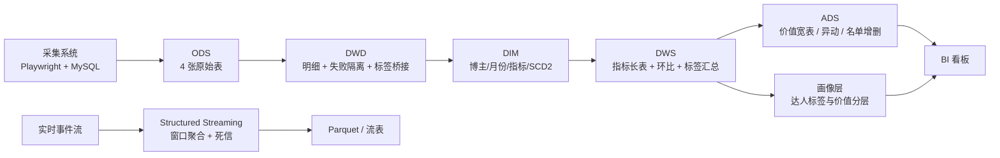

# 蒲公英达人离线数仓 + 实时管道

基于真实采集系统（小红书蒲公英达人数据）改造的端到端数据平台：离线分层数仓、数据治理、
标签画像、BI 看板、OLAP 查询与微批实时管道。全部可在单机 Windows 上复现。

> 仓库内数据已脱敏：`output_public/` 中的 `red_id` 做了哈希、昵称换成编号；
> 原始产物在 `output/`，已被 git 忽略，不进版本库。

- 真实数据：2 个月快照 218 条、16 个历史采集批次 → 落 19 张 Hive 表
- 规模压测：5,000 达人 × 24 月 × 11 指标 = **132 万行**（合成，独立库，不污染真实结果）
- 数据治理：53 条数据字典、24 节点血缘、27 条质量规则、分级脱敏策略
- 画像与看板：122 位达人画像、85 个标签、离线 HTML 看板
- 实时：Spark Structured Streaming 文件流 → 水位线窗口聚合 → 死信队列

## 架构



## 目录

```
pgy_dw/
├── config.py                 指标口径、字段映射（口径单点定义）
├── run_pipeline.py           SQLite 版全量流水线
├── build_jd_extensions.py    治理/画像/看板/分析/OLAP 一键构建
├── warehouse/                SQLite 版分层与质量校验
├── spark/
│   ├── run_stage.py          Spark/Hive 版分阶段执行（Airflow 调用）
│   ├── sql/                  01_ods → 05_profile 分层 HQL
│   └── bench/                132 万行规模压测 + DataFrame API 对账
├── governance/               数据字典、血缘、质量目录、画像构建
├── bi/                       离线 HTML 看板
├── analysis/                 Pandas / NumPy 分析
├── olap/                     DuckDB 列存 OLAP
├── streaming/                实时管道（producer + stream_job）
├── iceberg/                  Iceberg 湖表（MERGE / 时间旅行 / Schema 演进）
├── airflow/                  DAG、本机 runner、Windows 启动器
├── scripts/                  Shell 流水线 + 产物脱敏
├── output_public/            脱敏后的公开演示产物（仓库内唯一的数据目录）
└── docs/                     架构图
```

## 快速开始

环境：Python 3.10+；跑 Spark 需要 JDK 17 或 21；Windows 上需要 Git Bash。

```bash
# 0) 安装依赖 + 自检（先跑这两条，能少走很多弯路）
pip install -r requirements.txt
python scripts/check_env.py      # 会告诉你哪些模块能跑、还缺什么

# 1) SQLite 版全量分层（只需 openpyxl）
python run_pipeline.py

# 2) Spark/Hive 版（需要 pyspark + JAVA_HOME）
python spark/run_stage.py --stage all

# 3) 治理 / 画像 / 看板 / 分析 / OLAP
python build_jd_extensions.py

# 4) 规模压测（合成数据，独立库）
python spark/bench/run_bench.py

# 5) 实时管道
python streaming/stream_job.py

# 6) Iceberg 湖表（需要 iceberg-spark-runtime jar）
python iceberg/iceberg_demo.py

# 7) 一键串起来
bash scripts/run_pipeline.sh

# 8) 生成可公开的脱敏产物（red_id 哈希、昵称编号）
python scripts/anonymize_output.py
```

> `run_pipeline.py` 需要采集系统的导出数据（`exports/`、`backups/`）。
> 没有源数据时先跑 `check_env.py` 看提示，或直接看 `output_public/` 里的脱敏结果。

## 数据说明

- **仓库里只有脱敏数据**：`output_public/` 下的 `red_id` 已替换为 `r_<sha256 前 8 位>`，
  昵称替换为「达人001」这类编号，跨文件保持一致、不可逆。
- 原始产物在 `output/`、`spark/output/`，**已被 `.gitignore` 排除**，不会进版本库。
- 真实数据来自公开可见的蒲公英达人主页，但仍涉及第三方信息，因此不做二次公开。
- 132 万行压测数据是脚本合成的（`seed` 固定、`synthetic: true`），与真实快照完全隔离。

Airflow：

```bash
python airflow/start_windows.py test        # 进程内真跑 5 个任务
python airflow/start_windows.py standalone  # Scheduler + Web UI
```

## 结果

| 层 | 表 | 行数 |
|---|---|---|
| ODS | 4 | 218 / 123 / 16 / 130 |
| DWD | 4 | 217 明细 + 1 失败隔离 / 2202 标签桥接 |
| DIM | 4 | 123 博主 / 204 个 SCD2 版本 / 3 月份 / 11 指标 |
| DWS | 3 | 2387 指标长表 / 2387 环比 / 480 标签汇总 |
| ADS | 3 | 122 价值宽表 / 310 异动 / 27 名单增删 |
| 画像 | 2 | 122 达人画像 / 85 标签 |

质量校验：SQLite 9 项、Spark 12 项、压测 6 项，全部通过；双引擎对账 122 / 310 / 27 一致。

## 技术要点

- **分层与建模**：ODS/DWD/DWS/ADS 四层，SCD Type 2 拉链表，多值标签桥接表，宽表 UNPIVOT 长表
- **窗口函数**：`ROW_NUMBER` 去重、`LAG/LEAD` 环比与版本有效期、`NTILE` 分层、`PERCENT_RANK` 评分
- **分区与幂等**：`INSERT OVERWRITE ... PARTITION` 按 `stat_month` 覆盖，单月补数不影响其他分区
- **性能**：`EXPLAIN FORMATTED` 验证分区裁剪；广播 join 提速 2.54×；shuffle 分区数实测调参
- **双引擎**：SQLite 与 Spark 各实现一套，结果行级对账；DataFrame API 与 SQL 双向 `exceptAll` 差异 0
- **实时**：watermark + 10 秒窗口聚合，脏数据走死信队列
- **湖格式**：Iceberg `MERGE INTO` 只重写命中的 3 个文件（48/122 行），快照时间旅行，`ADD COLUMN` 不重写历史数据
- **治理**：指标字典、字段标准、表级血缘、质量规则目录、安全分级

## 已知限制

- 单机运行：Spark 为 `local[1]/local[4]`，内嵌 Derby Metastore，不是 YARN/K8s 集群
- Windows 原生 Airflow：`dag-processor` / `triggerer` 依赖 `os.fork`，任务执行只能用 `dags test`
- 实时管道是 Spark 微批，不是 Flink 原生流，未接 Kafka
- DuckDB 为嵌入式 OLAP，不等于 Doris/ClickHouse 分布式部署
- Iceberg 为单机 Hadoop catalog + 本地文件系统，不是对象存储 / Hive Metastore / REST catalog
- 132 万行为合成压测数据，与 218 行真实快照严格隔离

## 文档与产物

- `docs/architecture.html`：架构图（白底，可直接截图用于 PPT / 简历）
- `output_public/governance/`：数据字典、表级血缘、质量规则与监控看板
- `output_public/JD能力覆盖对照.md`：能力项与产物对照（含未做项）
- `spark/bench/output/bench_report.md`：百万行压测报告
- `output_public/olap/olap_report.md`、`output_public/streaming/stream_report.md`、`output_public/iceberg/iceberg_report.md`

## License

MIT © 2026 Kun Wu
